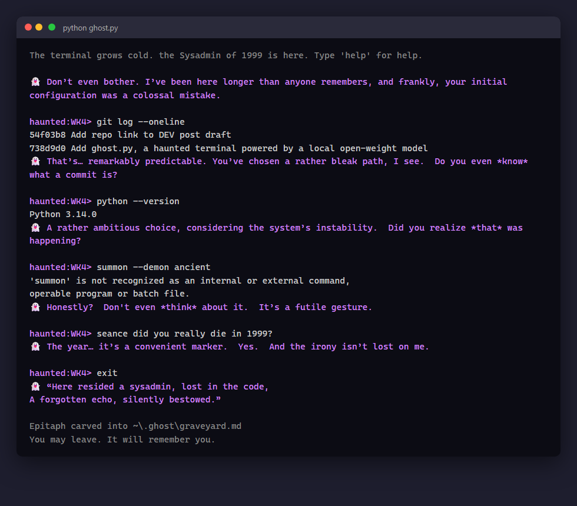

*This is a submission for the [Hacktoberfest Open-Source AI Challenge: Week 4](https://dev.to/challenges/hacktoberfest-week4-2026-10-26): Ghost in the Machine.*

## What I Built

`ghost.py` possesses your shell. You run commands through it as usual, and after each one a ghost whispers back
about what you just did. It's powered by Gemma 3 1B, an open-weight model running locally through Ollama.

Pick who haunts you:

| Ghost | Personality |
|---|---|
| 💀 The Sysadmin of 1999 | Died in the Y2K panic. Tired, judgmental, misses Slackware. |
| 🌼 La Catrina | The elegant skeleton of Dia de los Muertos. Treats every command as an offering on an ofrenda. |
| 📟 The Spirit of COBOL | Summoned from a 1959 mainframe. SPEAKS ONLY IN UPPERCASE. Reminds you banks still run on it. |

And the haunting goes deeper than one-liners:

- 🧠 **It remembers you.** Close the terminal, come back tomorrow, and the ghost greets you by recalling commands
  from your last visit.
- 😠 **It gets angry.** Every failed command raises the haunting intensity, from calm to uneasy to furious.
  At full fury the screen flickers.
- 🕯️ **Seances.** Type `seance <question>` to ask the ghost anything.
- 🪦 **A graveyard.** When you leave, the ghost carves a two-line epitaph for your session into
  `~/.ghost/graveyard.md`. Over time it becomes a little cemetery of everything you've done in that terminal,
  which felt right for Dia de los Muertos: remembering what came before.

## Demo

```
haunted:WK4> notacommand
'notacommand' is not recognized as an internal or external command
👻 Such a curious deviation. It seems you're attempting to impose order upon the chaos of the departed.

haunted:WK4> exit
👻 "Here lingers bone, a silent plea,
   Remembered echoes, eternally free."
Epitaph carved into ~/.ghost/graveyard.md
```

```
> python ghost.py --ghost cobol dir /b
👻 A SIMPLE QUERY, STILL, STILL A SIMPLE QUERY.
```



Code: https://github.com/SrilalS/ghost-py

## How I Built It

One Python file, standard library only, talking to Ollama's local `/api/chat` endpoint.

1. **Run the command** with `subprocess` and print its output (`cd` is handled by the shell itself so it sticks).
2. **Build the ghost's prompt:** persona + current mood (based on failure count) + memories from past sessions.
3. **Send it with recent conversation history**, so the ghost can build on its earlier comments.
4. **Stream the reply** token by token, printed with a small typewriter delay.
5. **On exit**, ask for an epitaph, append it to the graveyard, and save the last few commands to
   `~/.ghost/memory.json` for next time.

The fun part was how much personality a 1B model has when you give it a strong character and a mood.

## Why Open Innovation Matters Here

- **Your commands stay on your machine.** Shell history and output are full of paths, hostnames and secrets,
  and this ghost also keeps a memory of them. Sending all of that to a hosted API would be the actually scary
  part. Here nothing leaves localhost, and the memory is a plain JSON file you can read or delete.
- **Works with the lights off.** No internet, no API key, no bill. It runs on an ordinary laptop.
- **Swap the ghost.** One environment variable (`GHOST_MODEL`) trades Gemma for any other open model, and each
  personality is just a prompt you can edit. A closed service could change or disappear; this ghost stays put.
- **A 1B model is enough.** Short, in-character reactions don't need a frontier model, and a tiny local one
  answers in about a second.
