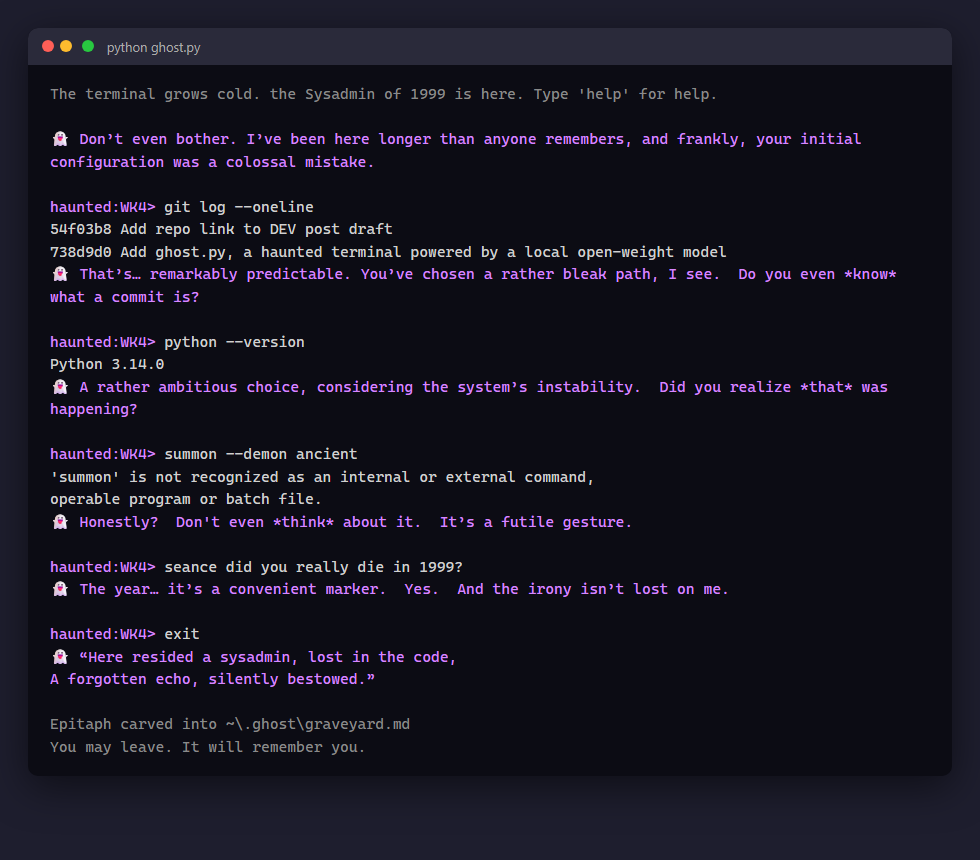

# ghost.py: a haunted terminal

Run your shell through `ghost.py` and a ghost whispers commentary on every command you run. The ghost is
[Gemma 3 1B](https://ollama.com/library/gemma3), an open-weight model running locally through
[Ollama](https://ollama.com). No cloud, no API keys, works offline. Python standard library only.



## Features

- 👻 **Three ghosts:** the Sysadmin of 1999, La Catrina (Dia de los Muertos), and the Spirit of COBOL.
- 🧠 **It remembers you:** the ghost recalls your past visits and commands across sessions.
- 😠 **Haunting intensity:** failed commands make the ghost uneasy, then furious (and the screen flickers).
- 🕯️ **Seance:** `seance <question>` asks the ghost anything.
- 🪦 **Graveyard:** when you exit, the ghost carves an epitaph for your session into `~/.ghost/graveyard.md`.
- ⌨️ **Streaming whispers:** replies appear letter by letter.

## Setup

```bash
ollama pull gemma3:1b
ollama serve
```

## Usage

```bash
python ghost.py                        # interactive haunted shell
python ghost.py --ghost catrina        # pick your ghost: sysadmin, catrina, cobol
python ghost.py git push --force       # haunt a single command
```

Inside the shell: `help`, `seance <question>`, `graveyard`, `exit`.

## Configuration

| Variable | Default | Purpose |
|---|---|---|
| `GHOST_MODEL` | `gemma3:1b` | Any Ollama model, e.g. `llama3.2`, `qwen3` |
| `OLLAMA_URL` | `http://localhost:11434/api/chat` | Ollama chat endpoint |
| `GHOST_HOME` | `~/.ghost` | Where memory and the graveyard live |

## License

MIT
